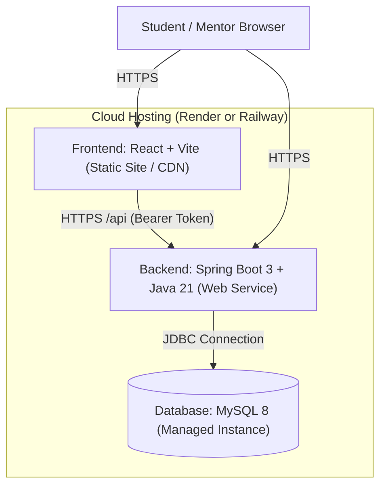

# SkillBridge Deployment Guide (Cloud PaaS: Render & Railway)

This guide walks you through deploying **SkillBridge** live to the cloud.

---

## Architecture of Deployed Services



---

## 🚀 Option 1: Deploying on Railway (Recommended & Fastest for MySQL)

Railway provides native **MySQL**, **Spring Boot**, and **Node.js** support in a single project with automatic GitHub integration.

### Step 1: Sign Up & Create New Project
1. Go to [railway.app](https://railway.app) and sign in with your GitHub account (`jashwanthmothukuri25`).
2. Click **+ New Project** → Select **Provision MySQL**.
3. Railway will immediately spin up a managed MySQL database and generate database credentials (`MYSQL_URL`, `MYSQLDATABASE`, `MYSQLUSER`, `MYSQLPASSWORD`, `MYSQLHOST`, `MYSQLPORT`).

### Step 2: Deploy the Spring Boot Backend
1. In the same Railway project dashboard, click **+ New** → **GitHub Repo**.
2. Select `jashwanthmothukuri25/skillbridge`.
3. In the service settings:
   - **Root Directory:** Set to `backend`
   - **Build Command:** `./mvnw clean package -DskipTests`
   - **Start Command:** `java -jar target/skillbridge-backend-1.0.0.jar`
4. Click on **Variables** and add:
   - `SPRING_DATASOURCE_URL`: `${{MySQL.MYSQL_URL}}` (or `jdbc:mysql://${{MySQL.MYSQLHOST}}:${{MySQL.MYSQLPORT}}/${{MySQL.MYSQLDATABASE}}?useSSL=false&allowPublicKeyRetrieval=true&serverTimezone=UTC`)
   - `SPRING_DATASOURCE_USERNAME`: `${{MySQL.MYSQLUSER}}`
   - `SPRING_DATASOURCE_PASSWORD`: `${{MySQL.MYSQLPASSWORD}}`
   - `PORT`: `${{PORT}}`
   - `JWT_SECRET`: `skillbridge_super_secure_secret_key_minimum_256_bits_2026_placement_track!`
   - `CORS_ALLOWED_ORIGINS`: `*`
5. Under **Settings** → **Networking**, click **Generate Domain** to get your public backend URL (e.g. `https://skillbridge-backend-production.up.railway.app`).
6. Flyway will automatically run on startup and initialize all 11 tables + seed data!

### Step 3: Deploy the React Frontend
1. In the same Railway project, click **+ New** → **GitHub Repo** → select `jashwanthmothukuri25/skillbridge`.
2. In the service settings:
   - **Root Directory:** Set to `frontend`
   - **Build Command:** `npm install && npm run build`
   - **Start Command:** `node server.js` (or leave empty)
3. Under **Variables**, add:
   - `VITE_API_URL`: `<YOUR_BACKEND_URL>/api` (e.g. `https://skillbridge-backend-production.up.railway.app/api`)
4. Click **Generate Domain** to get your live website URL!

---

## 🌐 Option 2: Deploying on Render

### Step 1: Set Up MySQL Database
1. Create a free MySQL database on [Aiven.io](https://aiven.io) or [Clever Cloud](https://www.clever-cloud.com) (or use Railway MySQL).
2. Note your JDBC URL, username, and password.

### Step 2: Deploy Backend Web Service on Render
1. Go to [render.com](https://render.com) and log in with GitHub.
2. Click **New +** → **Web Service**.
3. Connect your repository `jashwanthmothukuri25/skillbridge`.
4. Configure:
   - **Name:** `skillbridge-backend`
   - **Region:** Choose nearest (e.g., Singapore or Frankfurt)
   - **Root Directory:** `backend`
   - **Runtime:** `Java` (or Docker using `./backend/Dockerfile`)
   - **Build Command:** `./mvnw clean package -DskipTests`
   - **Start Command:** `java -jar target/skillbridge-backend-1.0.0.jar`
5. Add Environment Variables:
   - `SPRING_DATASOURCE_URL`: `<Your MySQL JDBC URL>`
   - `SPRING_DATASOURCE_USERNAME`: `<Your MySQL User>`
   - `SPRING_DATASOURCE_PASSWORD`: `<Your MySQL Password>`
   - `JWT_SECRET`: `skillbridge_super_secure_secret_key_minimum_256_bits_2026_placement_track!`
   - `CORS_ALLOWED_ORIGINS`: `*`
6. Click **Create Web Service**. Note your backend URL (e.g., `https://skillbridge-backend.onrender.com`).

### Step 3: Deploy Frontend Static Site on Render
1. Click **New +** → **Static Site**.
2. Connect `jashwanthmothukuri25/skillbridge`.
3. Configure:
   - **Name:** `skillbridge-frontend`
   - **Root Directory:** `frontend`
   - **Build Command:** `npm install && npm run build`
   - **Publish Directory:** `dist`
4. Add Environment Variable:
   - `VITE_API_URL`: `https://skillbridge-backend.onrender.com/api`
5. Under **Redirects/Rewrites**:
   - Rewrite rule is already handled by [`frontend/public/_redirects`](file:///Users/nallaningishivakaminigoud/SkillBridge/frontend/public/_redirects).
6. Click **Create Static Site**!

---

## 🐳 Option 3: Local or VPS One-Command Docker Deployment

If you want to run the full stack anywhere with Docker:
```bash
docker compose up -d --build
```
This automatically launches:
- MySQL on `http://localhost:3306`
- Spring Boot Backend on `http://localhost:8080`
- React Frontend on `http://localhost:3000`
