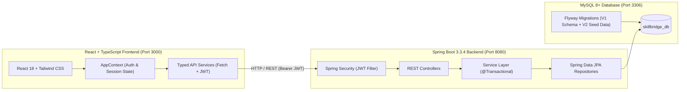

# SkillBridge — Full-Stack Mentorship Platform

> **"Bridge the Gap Between College and Industry"**  
> A full-stack web application connecting engineering college students with senior working professionals for 1-on-1 career guidance, mock system design rounds, and structured placement accelerator packages.

---

## 🏗️ Architecture Overview



### Technology Stack
- **Backend:** Java 21 LTS, Spring Boot 3.3.4, Spring Security 6 (Stateless JJWT `0.12.6`), Spring Data JPA / Hibernate 6, Bean Validation (Hibernate Validator), Flyway Migration Engine, MySQL Connector/J `8.3.0`, Spring Boot Actuator, JUnit 5, MockMvc.
- **Frontend:** React 18.3, TypeScript 5.6, Vite 5.4, Tailwind CSS 3.4, Lucide Icons, React Router 6.28.
- **Database:** MySQL 8.x / 9.x (`skillbridge_db`), fully normalized schema with foreign keys, indexes, pessimistic concurrency locks, and Flyway versioning.

---

## ⚡ Quick Start (VS Code & Terminal)

### Prerequisites
1. **Java:** OpenJDK 21 LTS (`java -version`)
2. **Maven:** Apache Maven 3.9+ or use the included `./mvnw` wrapper
3. **Node.js:** Node.js 18+ and npm (`npm -v`)
4. **MySQL Server:** Homebrew MySQL or local MySQL daemon running with database `skillbridge_db` created:
   ```bash
   mysql -u root -e "CREATE DATABASE IF NOT EXISTS skillbridge_db;"
   ```

---

### Running in VS Code

The project is preconfigured with VS Code Tasks in `.vscode/tasks.json`:

1. Open `/Users/nallaningishivakaminigoud/SkillBridge` in **VS Code**.
2. Press `Cmd + Shift + P` (or `Ctrl + Shift + P`), type **Tasks: Run Task**, and select:
   - **`SkillBridge: Start Fullstack (Backend + Frontend)`** — launches both servers concurrently!
   - Or individually:
     - **`Backend: Run Spring Boot`** (Starts Spring Boot on `http://localhost:8080`)
     - **`Backend: Run Tests`** (Executes JUnit 5 test suite)
     - **`Frontend: Start Vite Dev Server`** (Starts Vite on `http://localhost:3000`)

---

### Running via Terminal

#### Terminal 1: Backend (Spring Boot)
```bash
cd /Users/nallaningishivakaminigoud/SkillBridge/backend
./mvnw spring-boot:run
```
*The backend will automatically start on `http://localhost:8080` and Flyway will validate/migrate `skillbridge_db`.*

#### Terminal 2: Frontend (React + Vite)
```bash
cd /Users/nallaningishivakaminigoud/SkillBridge/frontend
npm install
npm run dev
```
*Open `http://localhost:3000` in your web browser.*

---

## 🔑 Demo Accounts (Pre-Seeded)

All demo accounts are pre-seeded in the database via Flyway migration `V2__seed_demo_data.sql` and work with one-click **Auto-Fill** on the login page:

| Role | Email | Password | Description | Default Dashboard |
| :--- | :--- | :--- | :--- | :--- |
| **Student** | `rohan.verma@college.edu` | `demoPass123!` | Final Year CSE Student | `/student` |
| **Mentor** | `aarav.sharma@google.com` | `demoPass123!` | Staff Software Engineer at Google | `/mentor` |
| **Admin** | `admin@skillbridge.edu` | `demoPass123!` | Platform Placement Dean | `/admin` |

---

## 🛡️ Database & Concurrency Protections

### 1. Snapshot Price Integrity
When a student books a package, the price is looked up from the database and permanently frozen on the `bookings` record (`amount_inr`). If the mentor later updates package pricing, existing bookings and platform audit histories remain unaffected.

### 2. Pessimistic Locking & Slot Double-Booking Prevention
Slot collisions are prevented at two distinct levels:
1. **JPA Pessimistic Write Lock (`PESSIMISTIC_WRITE`):**
   ```java
   @Lock(LockModeType.PESSIMISTIC_WRITE)
   @Query("SELECT s FROM AvailabilitySlot s WHERE s.id = :id")
   Optional<AvailabilitySlot> findByIdWithPessimisticLock(@Param("id") Long id);
   ```
   Locks the database row during booking validation, ensuring serial access even under concurrent HTTP threads.
2. **Database Constraint:**
   `bookings` table enforces a `UNIQUE KEY (slot_id)`, ensuring the database engine rejects any simultaneous booking attempt with `409 Conflict`.

---

## 📡 API Reference Table

All protected routes require `Authorization: Bearer <JWT>` header.

| HTTP Method | Endpoint | Allowed Roles | Request Body / Params | Description |
| :--- | :--- | :--- | :--- | :--- |
| `POST` | `/api/auth/login` | Public | `LoginRequest` (email, password) | Authenticate user & return signed JWT |
| `POST` | `/api/auth/register/student` | Public | `RegisterStudentRequest` | Register new student profile |
| `POST` | `/api/auth/register/mentor` | Public | `RegisterMentorRequest` | Register mentor application |
| `GET` | `/api/auth/me` | Authenticated | None | Fetch current authenticated user |
| `POST` | `/api/auth/logout` | Authenticated | None | Stateless session termination |
| `GET` | `/api/mentors` | Public | Query: `q`, `skill`, `company`, `sortBy` | Browse & search mentor directory |
| `GET` | `/api/mentors/{id}` | Public | Path: `id` | Get detailed mentor profile |
| `GET` | `/api/mentors/{id}/packages` | Public | Path: `id` | Get packages offered by mentor |
| `GET` | `/api/mentors/{id}/availability` | Public | Path: `id` | Get upcoming slots for mentor |
| `POST` | `/api/mentor/packages` | `MENTOR` | `PackageDto` | Create new mentorship package |
| `GET` | `/api/mentor/stats` | `MENTOR` | None | Mentor earnings & session stats |
| `GET` | `/api/bookings` | `STUDENT`, `MENTOR` | None | Fetch current user's bookings |
| `POST` | `/api/bookings` | `STUDENT` | `BookingRequest` (packageId, slotId, notes) | Concurrently reserve session |
| `GET` | `/api/bookings/{id}` | Participants / Admin | Path: `id` | Get booking detail |
| `POST` | `/api/bookings/{id}/cancel` | Participants | Path: `id`, Body: `reason` | Cancel session & release slot |
| `GET` | `/api/sessions/{bookingId}` | Participants / Admin | Path: `bookingId` | Access live video session room |
| `POST` | `/api/reviews` | `STUDENT` | `ReviewRequest` (bookingId, rating, comment) | Review completed session |
| `GET` | `/api/admin/stats` | `ADMIN` | None | Platform GMV, volume, users |
| `GET` | `/api/admin/mentors/pending` | `ADMIN` | None | Get mentor applications awaiting review |
| `POST` | `/api/admin/mentors/{id}/verify` | `ADMIN` | Path: `id` | Approve and verify mentor |
| `POST` | `/api/admin/mentors/{id}/reject` | `ADMIN` | Path: `id` | Reject mentor application |
| `GET` | `/api/admin/bookings` | `ADMIN` | None | Platform-wide booking audit ledger |

---

## 🧪 Testing Suite

### Running Backend Unit & Integration Tests
```bash
cd backend
./mvnw test
```
The test suite runs with in-memory H2 in MySQL compatibility mode:
- `AuthIntegrationTest`: Authentication, BCrypt hashing, duplicate email rejection.
- `BookingIntegrationTest`: Booking flow, pessimistic write locking, duplicate slot collision prevention (409 Conflict).
- `MentorIntegrationTest`: Directory filtering, package retrieval, slot availability checks.
- `AdminIntegrationTest`: Platform metrics, verification endpoints, role-based 403 authorization.
- `PasswordEncoderTest`: BCrypt encoder accuracy.

### Running Frontend Production Build
```bash
cd frontend
npm run build
```
Executes TypeScript type check (`tsc`) and Vite asset bundling with zero errors.

---

## 📂 Project Directory Structure

```
SkillBridge/
├── README.md                          # Full platform guide & architecture
├── .vscode/                           # Multi-root VS Code automation
│   ├── settings.json
│   └── tasks.json
├── backend/                           # Spring Boot 3.3.4 + Java 21 Backend
│   ├── pom.xml                        # Maven dependencies & build plugins
│   ├── mvnw & mvnw.cmd                # Maven Wrapper
│   ├── .env.example                   # Environment configuration template
│   └── src/
│       ├── main/
│       │   ├── java/com/skillbridge/
│       │   │   ├── SkillBridgeApplication.java
│       │   │   ├── config/            # Security, CORS, Password Encoder
│       │   │   ├── security/          # JWT Token Provider, Auth Filter, EntryPoint
│       │   │   ├── common/            # ApiResponse, Custom Exceptions, GlobalHandler
│       │   │   ├── auth/              # AuthController, AuthService, DTOs
│       │   │   ├── user/              # User, StudentProfile, Role, Repositories
│       │   │   ├── mentor/            # MentorProfile, Skill, MentorController
│       │   │   ├── packageoffer/      # MentorshipPackage, PackageController
│       │   │   ├── availability/      # AvailabilitySlot, AvailabilityController
│       │   │   ├── booking/           # Booking, BookingController, Concurrency Lock
│       │   │   ├── session/           # SessionRoom, SessionController
│       │   │   ├── review/            # Review, ReviewController
│       │   │   ├── payment/           # Payment, PaymentStatus
│       │   │   └── admin/             # AdminController, AdminService, AdminStatsDto
│       │   └── resources/
│       │       ├── application.yml    # Database, JPA & JWT configuration
│       │       └── db/migration/      # Flyway SQL scripts (V1 Schema, V2 Seed Data)
│       └── test/                      # Comprehensive integration test suite
└── frontend/                          # React + TypeScript + Vite Frontend
    ├── package.json
    ├── vite.config.ts                 # Configured with /api proxy to Spring Boot
    └── src/
        ├── types/index.ts             # Domain interfaces
        ├── services/                  # Typed API Client (api, auth, mentor, booking, admin)
        ├── context/AppContext.tsx     # Context provider with live backend integration
        ├── pages/                     # Landing, Discovery, Profile, Booking, Dashboards
        └── components/                # Reusable UI components
```
